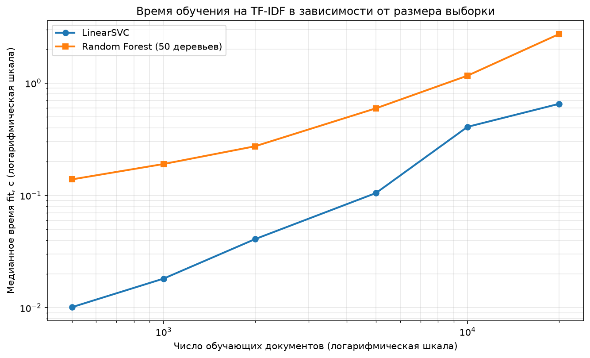

# Практическая работа № 9. Метод опорных векторов — вариант C

## Цель

Оценить применимость линейного SVM на высокоразмерных данных, сравнить его с ансамблевым методом и измерить изменение времени обучения при увеличении выборки.

## Данные и подготовка

Используется корпус русскоязычных отзывов RuReviews из ПР-6: после очистки и удаления дубликатов — **86 183 документа**, три класса. TF-IDF строится с `max_features=10000`, `min_df=2`, `max_df=0.95`, `ngram_range=(1, 2)`.

Сначала выполняется стратифицированное разделение 80/20, затем TF-IDF обучается только на train и применяется к test. Итоговые размеры: **68 946 × 10 000** для обучения и **17 237 × 10 000** для теста.

TF-IDF хранится в разреженном формате. Для LinearSVC используется `MaxAbsScaler` внутри пайплайна: он масштабирует признаки, не центрируя и не уплотняя матрицу. Визуализация на `make_moons` использует `StandardScaler` внутри пайплайна.

## LinearSVC и Random Forest

Обе модели обучаются на одинаковых TF-IDF-признаках. Время указано для `fit`; векторизация в него не входит. Время LinearSVC включает масштабирование.

| Модель | Accuracy | Macro-F1 | Обучение, сек |
|---|---:|---:|---:|
| **LinearSVC** | **0.7240** | **0.7238** | **3.32** |
| Random Forest (50 деревьев) | 0.7161 | 0.7165 | 19.65 |

В этом запуске LinearSVC показал Macro-F1 выше на 0.0072 и обучился примерно в 5.9 раза быстрее. Это результат конкретного разбиения и настроек, а не универсальная гарантия превосходства SVM.

## Рост времени при увеличении выборки

Для каждого размера сформировано стратифицированное подмножество обучающих данных. Время `fit` измерено трижды, в таблице и на графике приведена медиана. Векторизация выполнена заранее и в замеры не включена.

| Документов | LinearSVC, сек | Random Forest, сек |
|---:|---:|---:|
| 500 | 0.010 | 0.129 |
| 1 000 | 0.018 | 0.179 |
| 2 000 | 0.038 | 0.276 |
| 5 000 | 0.105 | 0.598 |
| 10 000 | 0.416 | 1.176 |
| 20 000 | 0.452 | 1.164 |



Замеры показывают общий рост времени на выбранном диапазоне, но отдельные точки не обязаны быть строго монотонными из-за вариативности времени выполнения. Не следует выводить из них точную асимптотическую сложность.

## Визуализация границ и влияние C

Для `make_moons` сравниваются линейное ядро (`C=1`) и RBF с `gamma="scale"` при двух значениях C:

| Модель | Accuracy на test |
|---|---:|
| Линейное, C=1 | 0.824 |
| RBF, C=0.1 | 0.888 |
| RBF, C=10 | **0.936** |

RBF лучше описывает нелинейную форму `make_moons`. При увеличении C штраф за ошибки на обучении растёт; в этом эксперименте более высокое C улучшило качество на тестовой части. Этот результат относится к конкретному разбиению и не исключает переобучения при дальнейшем увеличении сложности границы.

## Выводы

- Линейный SVM подходит для разреженных высокоразмерных текстовых признаков, когда качество сопоставимо с ансамблем, а скорость и память важны.
- В данном запуске LinearSVC немного превзошёл Random Forest по Macro-F1 и обучился быстрее.
- Ансамбль может быть предпочтительнее, если он заметно точнее на конкретных данных или лучше подходит для нелинейных зависимостей. Ядерный SVM на больших выборках может быть непрактичен из-за затрат на попарные взаимодействия; для текстов здесь поэтому используется линейный вариант.
- Время зависит от оборудования, версии библиотек и параметров моделей. Актуальные полные результаты запуска сохраняются в [results_summary.json](./results_summary.json).

## Предупреждение о сходимости

Предупреждение `LogisticRegression` относилось к прежнему сравнению на Breast Cancer, которое не относится к варианту C и удалено. Вместо подавления предупреждений SVM обучается на масштабированных разреженных признаках через `MaxAbsScaler`. Полный запуск обновлённого ноутбука не выдаёт предупреждений о несходимости моделей.

## Запуск

Из корня репозитория:

```powershell
Set-Location pr09-svm\notebooks
jupyter notebook pr09_svm.ipynb
```

Выполните ноутбук целиком через **Restart & Run All**. Данные скачиваются из публичного источника RuReviews; для запуска нужен доступ к сети. Ноутбук сохраняет таблицы и параметры в `../results_summary.json`, график масштабирования — в `../scaling_plot.png`.

## Используемые библиотеки

- pandas, NumPy
- scikit-learn
- matplotlib, Jupyter
